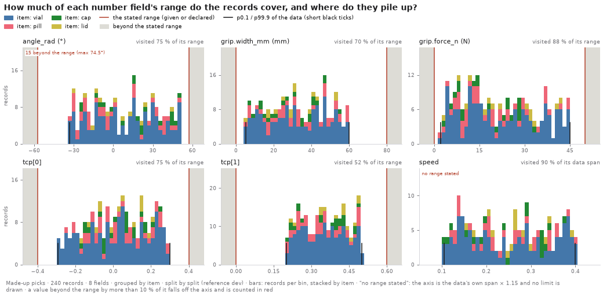

# dataclass-coverage

Any list of dataclass records in; how well the set covers the space its fields declare, out. Each field is measured
against its declared range, with class balance, missing values, pair planes, and the question "is more data still
adding coverage?". One JSON payload feeds four viewers: a [data-ui](https://github.com/zacharyyamaoka/data-ui) page,
Matplotlib PNGs, Viser, and Weights & Biases summary scalars.



```python
from dataclasses import dataclass
from dataclass_values import Value
from dataclass_coverage import analyze

@dataclass(frozen=True)
class Pick:
    item: str = Value("vial", choices=("vial", "pill", "cap", "box"))   # declared classes
    angle_rad: float = Value(0.0, "rad", low=-1.0, high=1.0)             # declared range
    width_mm: float = Value(40.0, "mm", low=0.0, high=80.0)
    split: str = "dev"

coverage = analyze(picks, group_by="item", split="split", pairs=[("angle_rad", "width_mm")])
coverage.numbers          # {'coverage_visited_pct': 36.0, 'class_imbalance_max': 11.4, 'missing_classes': 1, ...}
coverage.write_page("site/")   # the data-ui workbench; serve it: python -m http.server 8000 --bind 127.0.0.1 --directory site
coverage.plot("png/")          # numbers.png, classes.png, missing.png, pair-*.png, growth.png, support.png
coverage.serve_viser()         # the 3-D field (a 3-vector, or xyz=) as points in their declared box
coverage.log_wandb(run)        # payload["numbers"] -> run.summary, nothing else
```

## What it reads

- **Records:** dataclass instances of any depth, which includes [robot_msgs](https://github.com/zacharyyamaoka/robot_msgs)
  messages, or Mappings read from a JSON log. A nested dataclass or dict is flattened with dots (`pose.position.x`).
  A tuple or array of up to 4 numbers becomes one column per component (`tcp[0]`); anything longer becomes its length
  (`len(path)`). Public `@property` values are included.
- **Declared ranges:** the first one found wins.
  1. `ranges=`.
  2. The record's own `Value(low=, high=)` (from [dataclass-values](https://github.com/zacharyyamaoka/dataclass_values)).
  3. The class field default's `Value`: the class declares the space, the instances hold the measurements.
  4. A robot_msgs `Space`'s array bounds.

  Otherwise the range is the data's own span, and every viewer says "no range stated".
- **Classes:** `choices=`, `Value(choices=)`, an `Enum`'s members, or a bool's two values. A declared class that no
  record has is counted as a missing class.
- **Missing:** None, NaN and absent keys, counted per field and per record. They are never treated as a value.

## What it says

| | |
|---|---|
| Per number field | the counts against the range ± 10 % (the limits fall on bin edges, so overshoot shows), the % of the range visited, p0.1 / p99.9, the values beyond the range |
| Per category | the counts, declared levels first, unseen and undeclared levels, imbalance (largest ÷ smallest), effective classes (Hill N1), evenness |
| Per pair | a heat plane spanning exactly both ranges: % of cells visited, % with ≥ `enough` records, evenness |
| The whole set | the share of all cells visited as records are added (in your order, and the median and p10–p90 of 32 shuffles); the last 10 %'s new cells; a Chao1 ceiling ("more of the same reaches about X %"); cells each record was first to visit, and cells only it visits |
| With a split | held-out support: the share of holdout records sitting in cells the reference split never visits |

The payload is plain JSON (`json.dumps(payload, allow_nan=False)` works), and every viewer reads only the payload. The
bins are `np.histogram`'s, on the edges the payload writes, so any reader re-binning with numpy gets the same counts.
The contract, field by field: [docs/CONTRACT.md](docs/CONTRACT.md).

## The viewers

- **The page** (`write_page` / `write_workbench`): a data-ui `<data-workbench>`. A filter rail of category fields,
  tabs (Overview, Numbers, Classes, Pairs, Missing, Growth, Support, Records), one gear for the heat colours (five
  perceptually uniform maps, Reverse, linear / log / equalized scales), and data-ui's table for the records.
  - Ticking a class recounts every figure exactly. The figures are drawn from part rows per cohort, the records
    that share every rail value.
  - data-ui is vendored into the folder from a checkout (`DATA_UI`, default `~/data-ui`), or pass `kit=` to reuse one.
- **Matplotlib** (`plot_records`): one PNG per figure, with a legend on every figure. Empty is white, beyond a limit
  is grey, and a limit is a red line.
- **Viser** (`serve_records`): the points coloured by class, with a legend, in their declared box. It draws on plain
  viser (loopback only, no logo), or on the `viser_3d_viewer` house viewer when it is installed.
- **W&B** (`log_records`): the headline numbers as run-summary scalars, nothing else. `wandb` is never imported; pass
  your run.

Command line: `python -m dataclass_coverage rows.jsonl --out site/ --group-by item --split split --range x_m 0 1`.

## Prior art

TFDV / Facets Overview (a statistics row per feature, with the schema's domain as its range); ecology's
species-accumulation curve and Chao1 estimator; Hill numbers. The dataclass is the schema: no protobuf, no TensorFlow.

## Install and test

```bash
pip install "dataclass-coverage[viz,viser] @ git+https://github.com/zacharyyamaoka/dataclass_coverage"
uv run --isolated --extra test python -m pytest -q
```

The page tests also drive headless Chrome. They need a data-ui checkout (`DATA_UI`), Node's Playwright
(`PLAYWRIGHT_MODULE`, the path to its package) and Chrome (`CHROME`), and they skip without them.

MIT licence.
